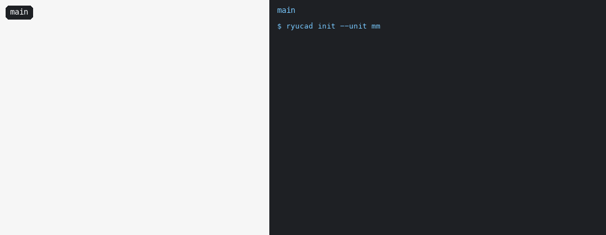

# ryucad

CAD built for AI agents to drive, with a from-scratch B-rep kernel (**ryukei**) designed for large-assembly performance. The long-term target is Parasolid-level capability.

> **Alice: "Widen the hub's bore to 16 mm and thin the ribs to 3 mm."**
> **Bob: "Make the flange 72 mm across and the ribs 6 mm thick."**

<p align="center">
  
</p>

Two agents change one part on two branches, and Git merges them. A ryucad model is a folder of plain feature files in a Git repo. ryucad registers itself with Git, so `git diff` reads as values (`parameters.bore = 16 mm`, not JSON), and `git merge` merges files by value. Here the bore and the flange merge cleanly. Rib thickness is a real conflict, so it is recorded in the file, which stays valid JSON with no conflict markers. `ryucad merge status` reports it with its base, ours and theirs, and `ryucad merge resolve` settles it. The commit hook won't let the merge through until it is settled, and `ryucad check` rebuilds the result from nothing. Every frame of the model was drawn by `ryucad render`, and humans can watch the same session live in `ryucad-app`, which ghosts a revision and colours what changed.

<details>
<summary>What the agents ran</summary>

```sh
ryucad init --unit mm                    # in a Git repo: also registers the diff and merge drivers and the hooks
ryucad part create hub
ryucad param set hub "bore=12 mm" "flange_d=60 mm" "flange_t=6 mm" "hub_d=28 mm" "height=30 mm" "rib_t=4 mm"
ryucad feature add hub sketch --id profile --plane zx
ryucad sketch edit hub profile @profile.json        # the profile, dimensioned by the parameters
ryucad feature add hub revolve --id body --sketch profile --axis l7 --angle full
ryucad feature add hub sketch --id ribs_a --plane zx
ryucad sketch edit hub ribs_a @ribs_a.json
ryucad feature add hub extrude --id ribs_x --sketch ribs_a --length rib_t --extent symmetric
ryucad feature add hub sketch --id ribs_b --plane yz
ryucad sketch edit hub ribs_b @ribs_b.json
ryucad feature add hub extrude --id ribs_y --sketch ribs_b --length rib_t --extent symmetric
git add -A && git commit -m hub

git switch -c alice
ryucad --as alice param set hub "bore=16 mm" "rib_t=3 mm"
git commit -am "alice: wider bore, thinner ribs"

git switch -c bob main
ryucad --as bob param set hub "flange_d=72 mm" "rib_t=6 mm"
git commit -am "bob: bigger flange, thicker ribs"

git switch alice && git merge bob       # bore and flange_d merge; rib_t is a conflict
ryucad merge status
ryucad merge resolve 'parts/hub/parameters.json#/parameters/rib_t' --theirs
git add -A && git commit -m "merge bob"
ryucad check
ryucad diff --from main --model          # what the merge did to the bodies, face by face
```

`scripts/hero.sh target/release/ryucad` rebuilds the model, the branches, the merge and the animation (it needs Git and Python with Pillow).

</details>

## Why

- **Agents model, humans watch.** Every operation is a CLI command or a JSON-RPC request with structured errors and stable codes. The desktop app is a viewer for people to watch, point and judge, and its every action is also a command.
- **A model is a folder of text files in Git.** Features are written as canonical JSON, one file each, so history, branches and review all come from Git. ryucad's drivers make `git diff` read as values and `git merge` merge by value. Conflicts are recorded in the files, and the merge is checked by rebuilding it. Bodies, meshes and renders are only a cache.
- **References survive edits.** Faces, edges and vertices have stable names derived from the operations that made them, so a reference never silently lands on the wrong edge after a rebuild. This is the "toponaming" problem that FreeCAD suffers from.
- **A kernel built for scale and agreement.** ryukei stores topology in flat arrays and runs in parallel from the start. It makes topology decisions with exact or certified predicates and produces bit-identical results on every OS and CPU, checked by golden hashes in CI.

## What's in the box

| Layer | Crate | What works today |
|---|---|---|
| Kernel | `crates/ryukei` | Box, cylinder, sphere, cone and torus; rational NURBS curves and surfaces; extrude and revolve from validated profiles; certified, watertight, parallel tessellation; certified curve and surface intersections and a self-intersection check; unite, intersect and subtract with any number of tools, through fillets too; pipes, constant-radius fillets and chamfers on edges and tangent chains, and the corners where they meet |
| STEP | `crates/ryustep` | Reading and writing Part 21 files; AP203, AP214 and AP242 entities typed for B-rep solids; units and the product tree (bodies to and from the kernel come next) |
| Sketch solver | `crates/ryusketch` | Points, lines, arcs and circles with geometric and dimensional constraints, solved block by block; degrees of freedom, and redundant and conflicting sets reported |
| Application | `crates/ryucad` | Projects of feature files; parameters and expressions with units; sketches, extrude and revolve; references to earlier features by stable name; incremental recompute; the agent CLI and per-project session daemon; activity log with undo; renders; `doctor`; Git: any revision rebuilt, `git diff` as values, `ryucad diff --model`, `ryucad check`, a merge driver that merges by value, merge status and resolution, commit hooks |
| Desktop app | `crates/ryucad-app` | A live viewer (egui and wgpu) attached to the daemon: feature tree, properties, sketches and their dimensions, parameters, history, picking that yields stable references, settings; a compare view that ghosts a Git revision and colours what changed; a conflict panel during merges |
| PDM | `crates/ryupdm` | Part properties and numbers, revision labels, release records in the repo, the release branch's history and tags, part states, release checks and a commit guard |
| Testing | `crates/ryukei-testkit`, `crates/ryukei-bench`, `fuzz/` | Seeded and property tests, fuzz targets, golden hashes, and head-to-head comparisons with OCCT and SMLib |

Booleans and fillets are in the kernel but not yet features in ryucad; that is ryucad phase 4. Design documents and roadmaps live in the Coxswain planning project `ryucad-ryukei`, not in this repo.

## Roadmap and releases

Three layers, each with its own phased roadmap: **ryukei** (the kernel), **ryucad** (the application) and **ryupdm** (product data management, built on ryucad projects in Git).

### Released

| Release | Date | What it brought |
|---|---|---|
| [v0.1.0](https://github.com/Seiraiyu/ryucad/releases/tag/v0.1.0) | 2026-10-16 | ryukei phases 0–3: deterministic math, tolerances and exact predicates; flat-array topology, Euler operators, stable names and the five primitives; NURBS geometry; certified tessellation. ryucad phase 0: projects of feature files, the agent CLI, the session daemon, installers |
| [v0.2.0](https://github.com/Seiraiyu/ryucad/releases/tag/v0.2.0) | 2026-10-18 | ryucad phase 1: the live session (participants, notifications, activity log and undo, settings, Git history, meshes, renders, `doctor`) and the desktop app, `ryucad-app` |
| [v0.2.1](https://github.com/Seiraiyu/ryucad/releases/tag/v0.2.1) | 2026-10-18 | ryukei phase 4: extrude and revolve from 2D profiles |
| [v0.2.2](https://github.com/Seiraiyu/ryucad/releases/tag/v0.2.2) | 2026-10-19 | ryukei phase 5.A: pcurves on every edge, and cavities |
| [v0.3.0](https://github.com/Seiraiyu/ryucad/releases/tag/v0.3.0) | 2026-10-20 | ryukei phase 5 complete (certified intersections, the self-intersection check, booleans) and 6.A (pipes). ryucad phases 2.A–2.C: parameters and expressions, the sketch solver, sketches to extrudes and revolves, references by stable name, incremental recompute. App looks (`ui.style`) |
| [v0.3.1](https://github.com/Seiraiyu/ryucad/releases/tag/v0.3.1) | 2026-10-21 | ryukei phase 6.B: constant-radius fillets and chamfers on edges and tangent chains. ryucad phase 2.D: sketches, labels and the parameter panel in the app, and solver stage 2 |
| [v0.4.0](https://github.com/Seiraiyu/ryucad/releases/tag/v0.4.0) | 2026-10-22 | ryukei phase 6 complete: corners (6.C), booleans on blends and hardening (6.D). ryucad phase 3, the Git-native workflow: any revision rebuilt, `git diff` as values, `ryucad diff` and `ryucad check` (3.A); the merge driver, merge status and resolution, and the hooks (3.B); the app's compare view and conflict panel (3.C) |
| `main`, unreleased | | ryukei phase 7.A: STEP files (`ryustep`). ryupdm phase 1.A and 1.B: the `ryupdm` crate, properties, revisions, release records, tags and the commit guard |

### Next

| Layer | Now | Then |
|---|---|---|
| ryukei | Phase 7, STEP interop: bodies both ways (7.B), healing imported geometry (7.C), real-world files (7.D) | 8 full NURBS (general intersections, NURBS booleans and blends, offset, shell, loft), 9 Parasolid-class (direct editing, sheets, draft, mass properties) |
| ryucad | Phase 4, solid modeling: boolean, fillet, chamfer, hole, pattern and shell features | 5 assemblies, 6 STEP, 7 scale (10k+ part assemblies), 8 other formats and drawings |
| ryupdm | Phase 1, local PDM: releases in `merge status`, `diff` and textconv (1.C), then releases in the app (1.D) | 2 hosted review, 3 where-used and BOM, 4 release workflow, 5 multi-repo, 6 teams and hosting |

Roadmaps are plans, not commitments; versions aren't assigned ahead of time.

## Building from source

The toolchain is pinned in `rust-toolchain.toml`; the default build has no C++ dependency.

```sh
cargo build --workspace
cargo test --workspace
cargo run -p ryucad -- --help
cargo build && cargo run -p ryucad-app -- <project folder>   # the app needs ryucad built beside it
```

## Install

Prebuilt binaries for Linux (x86_64 and aarch64), macOS (Apple silicon) and Windows (x64) are published with each release: the `ryucad` command (static on Linux) and the desktop app, `ryucad-app` (on Linux it needs glibc 2.35 or newer and a desktop). The installers put both in `~/.ryucad/bin`, add it to your PATH, and let you open a project folder in the app from your desktop: "Open in ryucad" on folders in Explorer, an application entry on Linux that also opens `ryucad.json`, and `~/Applications/ryucad.app` on macOS (drop a folder on it, or `open -a ryucad <folder>`). Running one again updates.

While the repository is private, the installers need a GitHub token: they use `GH_TOKEN` or `GITHUB_TOKEN`, or ask `gh` (`gh auth login` first).

```sh
# Linux, macOS and WSL
gh release download -R Seiraiyu/ryucad -p install.sh -O - | sh
```

```powershell
# Windows (PowerShell)
gh release download -R Seiraiyu/ryucad -p install.ps1 -O install.ps1; Get-Content -Raw install.ps1 | iex
```

Once the repository is public, no token is needed:

```sh
curl -fsSL https://github.com/Seiraiyu/ryucad/releases/latest/download/install.sh | sh
```

```powershell
irm https://github.com/Seiraiyu/ryucad/releases/latest/download/install.ps1 | iex
```

Set `RYUCAD_VERSION=v0.1.0` to install a particular version, `RYUCAD_HOME` to install somewhere other than `~/.ryucad`, `RYUCAD_NO_MODIFY_PATH=1` to leave your shell profile alone, and `RYUCAD_NO_APP=1` to install the command only (servers, CI). `ryucad open [folder]` opens a project in the app, or brings its window forward.

To uninstall, run `ryucad daemon stop --all`, delete `~/.ryucad` (`%USERPROFILE%\.ryucad` on Windows), and remove the PATH line the installer added (marked `# added by the ryucad installer`) or the entry in your Windows user PATH. Then remove what lets the desktop open projects: on Linux `~/.local/share/applications/ryucad.desktop` and `~/.local/share/mime/packages/ryucad.xml` (then `update-mime-database ~/.local/share/mime`), on macOS `~/Applications/ryucad.app`, and on Windows the keys `HKCU\Software\Classes\Directory\shell\ryucad` and `HKCU\Software\Classes\Directory\Background\shell\ryucad`.

## Releasing

Merge, then push a tag `vX.Y.Z` (or `vX.Y.Z-rc.1` for a prerelease). The version comes from the tag: the repo's workspace version stays `0.0.0`, and the workflow stamps the tag's version in before building. The `Release` workflow builds and tests every target, publishes the archives with `SHA256SUMS` and both installers, and then tests the installers against the new release.
