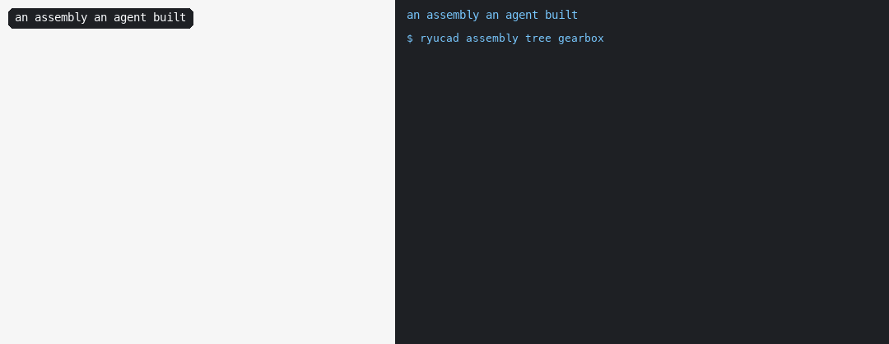
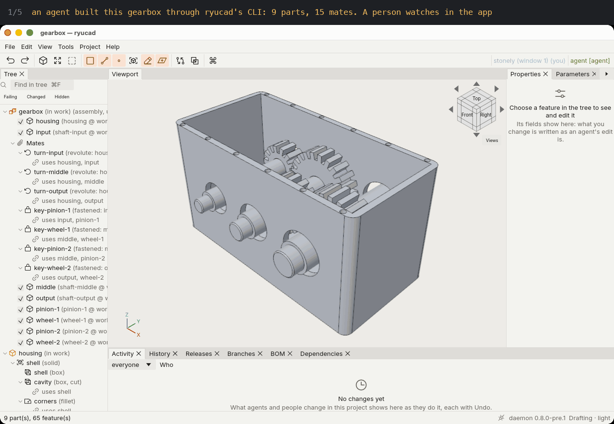

# ryucad

**CAD for AI agents to drive.** Agents model through a CLI and a JSON-RPC session; people watch, point and judge in a live viewer. Underneath is **ryukei**, a B-rep kernel written from scratch in Rust for large assemblies and identical results on every platform. The long-term target is Parasolid-level capability.

<p align="center">
  
</p>

An agent works on a gearbox. It reads the assembly's mates, gives the gears a material and weighs the result: the mass comes with a certified bound. Then it sweeps a section plane through the housing, explodes the assembly, rounds the housing's corners, and checks what that changed against Git's `HEAD`. It finishes by exporting STEP, 3MF and USDZ and listing the bill of materials. Everything in the GIF is a CLI command, and every model frame is `ryucad render`. The gearbox itself is one of the projects in `crates/ryucad/tests/corpus`, built by an agent through the same CLI (`gearbox.py`).

### The same session, watched in the app

<p align="center">
  
</p>

This is `ryucad-app` running on a Mac while the agent works, and nobody touched it. Agents show people what they did: `ryucad focus`, `section`, `explode show` and `compare` drive the person's window. Each change appears in the activity feed and as a toast with Undo, and the tree marks what changed.

<details>
<summary>How the GIFs are made</summary>

`scripts/hero.sh path/to/ryucad` copies the gearbox into a new Git repository and runs the session above. It needs Git and Python with Pillow. On a Mac, `scripts/hero.sh path/to/ryucad assets/hero.gif path/to/ryucad-app assets/app.gif` also opens the app and photographs its window at each step (it also needs `pyobjc-framework-Quartz`). Both GIFs here were made with the v0.8.0-pre.1 release binaries.

</details>

## Contents

- [Why ryucad](#why-ryucad)
- [What it does](#what-it-does)
- [Install](#install)
- [A first session](#a-first-session)
- [How it is built](#how-it-is-built)
- [Where it stands](#where-it-stands)
- [Building from source](#building-from-source)

## Why ryucad

- **Agents model, people watch.** Every operation is a CLI command or a JSON-RPC request with structured errors and stable codes. The CLI prints one JSON document per call and exits with a code an agent can act on. The desktop app is a viewer: people watch, select, measure, comment and undo, and everything the app can do is also a command. People don't model in it.
- **A model is a folder of text files in Git.** Each feature is one canonical JSON file, so history, branches, review and merges come from Git. ryucad registers drivers so `git diff` reads as values and `git merge` merges by value. Conflicts are recorded in the files, and a merge is checked by rebuilding it. Bodies, meshes and renders are only a cache.
- **References survive edits.** Faces, edges and vertices have stable names derived from the operations that made them. A reference never silently lands on the wrong edge after a rebuild, which is the "toponaming" problem FreeCAD suffers from.
- **A kernel built for scale and agreement.** ryukei stores topology in flat arrays and runs in parallel. It makes topology decisions with exact or certified predicates and gives bit-identical results on every OS and CPU, which golden hashes check in CI.
- **Built because OCCT wasn't enough.** FreeCAD was ruled out for large assemblies, and its kernel, OCCT, is a main reason. ryukei is compared head to head with OCCT and NVIDIA's SMLib in the devcontainer.

## What it does

### Parts

- **Parametric features:** sketches with a 2D constraint solver, then extrude, revolve, holes (counterbored, countersunk, drilled), linear, circular and mirror patterns, fillets, chamfers and booleans between solids.
- **Parameters and equations:** expressions with units, per part or project-wide, listed and edited as one table.
- **Reference geometry:** datum planes, axes and points (offset, at an angle, midplane, through three points, normal to a path and more), paths along edges and sketch curves, and helices.
- **Recompute:** each result is keyed by a hash of its inputs, so an edit rebuilds only what it reaches, and a disk cache keeps results between sessions.

### Assemblies, at scale

- **Instances and mates:** fastened, revolute, slider, cylindrical, planar and ball, solved by `ryumate`, which reports each body's freedom and any redundant or conflicting mates.
- **Patterns, exploded views and section planes.** Explodes are saved in Git beside the assembly; section planes belong to a person's window or a render.
- **Interference and clearance** between every pair of instances.
- **Scale:** 1,000 mates over 1,001 occurrences solve in 36 ms when their poses hold and 61 ms from poses a degree off. The 10,000-part benchmark (100,000 occurrences, 107,500 files) answers through a daemon over a warm cache in 6.5 to 6.8 s, and an edit reaches a subscriber in 119 to 287 ms. Both are on cox-worker-3 (Intel Core Ultra 5 250K Plus, 18 threads). Orbiting 100,000 occurrences still runs at about 12 fps there, short of its 60 fps bar (#237).

### Measure, mass and looks

- **Measure** distances, angles, lengths and areas between any entities, and **mass properties** from a project's material library. Every value is exact or carries a certified bound.
- **Appearance:** colours and opacity per part, solid, face or occurrence, and material colours, all kept in Git.
- **Views:** 29 standard views (the navigation cube's 26 among them), named views saved in Git, `normal to` a face, and renders of any of them.

### Exchange

- **STEP import:** AP203, AP214 and AP242, with healing, assemblies placed as their files place them, and re-import that keeps the stable names of unchanged geometry.
- **STEP export** of parts and assemblies, in millimetres or metres. A file exported as it was imported comes back byte for byte.
- **STL, 3MF and USD** (usda, usdc and usdz, with exact B-rep as omniSolid BrepArrays beside the meshes). The daemon writes each file itself.
- **Real files:** on cox-worker-2 (AMD Ryzen 7 9700X, 8 cores, shared), ryustep reads 1,598 parts in 125.8 MB of AP242 in 37 to 55 s. `step-hunt` runs the public corpora (NIST, OCCT's samples, KiCad's models) through the CLI and files what fails.

### Git, branches and agents in parallel

- **Any revision rebuilt**, `ryucad diff --model` face by face, and `ryucad check` from nothing.
- **Merges:** a merge driver that merges by value, `merge status` and `merge resolve`, and commit hooks that won't let an unsettled merge through.
- **Agents on branches:** `ryucad worktree add` gives each agent a worktree with its own daemon, all sharing one machine's cache. Any worktree can be compared with another, and `ryucad merge preview` reports what a merge would conflict on before anything is merged.

### The desktop app

`ryucad-app` (egui and wgpu) attaches to the project's daemon as a person. Since v0.8.0 it has:

- dockable tiles and a command palette;
- rebindable shortcuts with ryucad, SolidWorks and Onshape presets, and three looks in light, dark and high contrast;
- a searchable feature tree, the navigation cube and a selection filter;
- progress with Cancel, toasts, error cards and an activity feed with Undo;
- a compare view that ghosts a Git revision, and a conflict panel during merges;
- BOM, releases, branches and dependencies tabs.

It writes nothing itself: every change is the same request an agent sends.

### PDM: releases, BOMs and review

ryupdm is product data management on the same Git repositories. There is no second store.

- **Releases:** part properties and numbers, revision labels (ASME Y14.35 letters or numbers), release records in the repo, tags and part states. A commit guard stops a released part from changing unnoticed.
- **Product structure:** indented and flat BOMs from the files alone, item numbers, BOM diffs between revisions, CSV, and where-used across assemblies and their releases.
- **Approval rules,** checked offline in any clone against the signed tags the hosted service writes.
- **Multi-repo:** place another project's released parts, locked to commits in `ryucad.lock` and read offline once fetched.
- **Hosted review** at [review.seiraiyu.com](https://review.seiraiyu.com), the paid service, in an invite-only beta. It puts check runs and before-and-after renders on pull requests, a 3D viewer with comments pinned to faces, Merge in, BOM changes and approvals. It runs the released `ryucad` binary in a sandbox, so its verdicts are the CLI's. Its code is private; `ryucad review` is its client.

### Electronics: ryueda and ryudfm

Two more products in this repo share ryucad's files, sessions and CLI conventions. Both are early and have not been released yet.

- **ryueda** is electronics CAD for agents, on its own release line (`ryueda-vX.Y.Z` tags, `install-ryueda.sh`). It has symbol, footprint and component libraries, and imports KiCad libraries: on davids-m4 (Apple M4) it imported KiCad 9.0.9's 10,217 symbols and 15,361 footprints. It has hierarchical blocks, connectivity, the flattened netlist and ERC, and a schematic engine (`ryusch`) that lays out and draws schematics and lints how readable they are.
- **ryudfm** is design-for-manufacturing for boards, also on its own line. It reads ODB++ exactly into integer nanometres, then inspects and renders it. On cox-worker-4 (AMD Opteron 6380) it reads and shapes a 338,087-feature board in 0.71 to 0.76 s. Its copper measurement engine is under way.

## Install

Prebuilt binaries for Linux (x86_64 and aarch64), macOS (Apple silicon) and Windows (x64) come with each release. Each release has the `ryucad` command (static on Linux) and the desktop app, `ryucad-app` (on Linux it needs glibc 2.35 or newer and a desktop). The installers verify checksums and put both in `~/.ryucad/bin`. They add it to your PATH and register ryucad's Git drivers. They also let you open a project folder in the app from your desktop: "Open in ryucad" on folders in Explorer, an application entry on Linux that also opens `ryucad.json`, and `~/Applications/ryucad.app` on macOS. Running one again updates.

```sh
# Linux, macOS and WSL
curl -fsSL https://github.com/Seiraiyu/ryucad/releases/latest/download/install.sh | sh
```

```powershell
# Windows (PowerShell)
irm https://github.com/Seiraiyu/ryucad/releases/latest/download/install.ps1 | iex
```

Set `RYUCAD_VERSION=v0.8.0` to install a particular version, `RYUCAD_HOME` to install somewhere other than `~/.ryucad`, `RYUCAD_NO_MODIFY_PATH=1` to leave your shell profile alone, and `RYUCAD_NO_APP=1` to install the command only (servers, CI). `ryucad open [folder]` opens a project in the app, or brings its window forward.

<details>
<summary>Uninstall</summary>

Run `ryucad daemon stop --all`, delete `~/.ryucad` (`%USERPROFILE%\.ryucad` on Windows), and remove the PATH line the installer added (marked `# added by the ryucad installer`) or the entry in your Windows user PATH. `git config --global --remove-section diff.ryucad` and `merge.ryucad` take the Git drivers out. Then remove what lets the desktop open projects:

- **Linux:** `~/.local/share/applications/ryucad.desktop` and `~/.local/share/mime/packages/ryucad.xml`, then run `update-mime-database ~/.local/share/mime`.
- **macOS:** `~/Applications/ryucad.app`.
- **Windows:** the keys `HKCU\Software\Classes\Directory\shell\ryucad` and `HKCU\Software\Classes\Directory\Background\shell\ryucad`.

</details>

## A first session

```sh
mkdir bracket && cd bracket && git init
ryucad init --unit mm                     # in a Git repo: also the diff and merge drivers and the hooks
ryucad part create plate
ryucad param set plate "w=80 mm" "h=50 mm" "t=6 mm"
ryucad feature add plate box --id base --param x=w --param y=h --param z=t
ryucad inspect plate                      # its faces, edges and vertices by stable name
ryucad feature add plate fillet --id round --radius "4 mm" --edge plate/base/<edge name from inspect>
ryucad render plate --out plate.png
ryucad open                               # watch it in the app
ryucad check && git add -A && git commit -m plate
```

Every command answers one JSON document: `{"ok", "result" | "error", "warnings"}`. Errors have stable codes and say what to fix, and `--help` on any command lists its flags. To drive a running session over JSON-RPC instead, see `ryucad daemon --help`. `docs/claude/` records what each phase decided, area by area.

## How it is built

| Layer | Crates | What it is |
|---|---|---|
| Kernel | `ryukei`, `ryu-math` | The B-rep kernel. It has analytic surfaces and rational NURBS, extrusions, revolutions, sweeps, offsets and pipes, and certified intersections of every pair. On top of those: booleans with any number of tools, fillets and chamfers with their corners, sweeps along paths and lofts, offsets and shells, healing, tolerant modelling, sheet bodies, sheet-metal unfolding, measurement with bounds, certified watertight tessellation, and work budgets with cancellation. All deterministic, from `ryu-math`'s portable `libm` |
| Exchange | `ryustep`, `ryu-part21`, `ryuformats` | STEP both ways, and STL, 3MF and USD (usda, usdc, usdz) |
| Solvers | `ryusketch`, `ryumate` | The 2D sketch solver and the assembly mate solver, by block decomposition, with freedom and redundancy reported |
| Application | `ryucad`, `ryucad-doc`, `ryu-doc`, `ryu-session` | Projects of feature files, the agent CLI, the per-project session daemon (participants, notifications, activity and undo), recompute and the disk cache, Git integration, renders and `doctor` |
| App | `ryucad-app` | The live viewer |
| PDM | `ryupdm` | Local PDM: properties, releases, BOMs, where-used, approvals, dependencies |
| Electronics | `ryueda`, `ryusch`, `ryudfm`, `ryu-board`, `ryu-copper` | Electronics CAD, schematics, and board DFM |
| Testing | `ryukei-testkit`, `ryukei-bench`, `step-hunt`, `fuzz/` | Seeded property tests, golden hashes on every platform, 32 fuzz targets, corpora of real files, and head-to-head comparisons with OCCT and SMLib |

The default build has no C++ dependency; OCCT and SMLib appear only behind features of `ryukei-bench`. Design documents and roadmaps live in the Coxswain planning project `ryucad-ryukei`, not in this repo.

## Where it stands

### Releases

| Release | Date | What it brought |
|---|---|---|
| [v0.1.0](https://github.com/Seiraiyu/ryucad/releases/tag/v0.1.0) | 2026-10-16 | The kernel's foundations: deterministic math and exact predicates, flat-array topology with stable names, NURBS geometry and certified tessellation. Projects of feature files, the agent CLI and the session daemon |
| [v0.2.0](https://github.com/Seiraiyu/ryucad/releases/tag/v0.2.0) – [v0.2.2](https://github.com/Seiraiyu/ryucad/releases/tag/v0.2.2) | 2026-10-18 – 19 | The live session (participants, notifications, activity and undo, renders, `doctor`) and the desktop app; extrude and revolve; pcurves and cavities |
| [v0.3.0](https://github.com/Seiraiyu/ryucad/releases/tag/v0.3.0), [v0.3.1](https://github.com/Seiraiyu/ryucad/releases/tag/v0.3.1) | 2026-10-20 – 21 | Certified intersections and booleans; pipes, fillets and chamfers. Parameters, the sketch solver, references by stable name, incremental recompute |
| [v0.4.0](https://github.com/Seiraiyu/ryucad/releases/tag/v0.4.0) | 2026-10-22 | Blend corners. The Git-native workflow: any revision rebuilt, `git diff` as values, the merge driver, merge status and resolution, hooks, the app's compare view and conflict panel |
| [v0.5.0](https://github.com/Seiraiyu/ryucad/releases/tag/v0.5.0), [v0.5.1](https://github.com/Seiraiyu/ryucad/releases/tag/v0.5.1) | 2026-10-26 | Solids, fillets, chamfers, holes and patterns as features. STEP bodies both ways and healing. Assemblies, mates and the disk cache. Local PDM: properties, releases, tags and the commit guard |
| [v0.6.0](https://github.com/Seiraiyu/ryucad/releases/tag/v0.6.0) | 2026-10-27 | Intersections of every surface, sweeps along paths and lofts. Interference. STEP import and re-import of parts and assemblies |
| [v0.7.0](https://github.com/Seiraiyu/ryucad/releases/tag/v0.7.0) | 2026-10-30 | Booleans and blends on every surface, offset surfaces. STEP export; STL, 3MF and USD. The daemon at scale, the shared cache's client, agents on worktrees. Measure, mass and materials, views and the navigation cube, appearance. BOMs, item numbers and where-used. The first ryueda and ryudfm crates |
| [v0.7.1](https://github.com/Seiraiyu/ryucad/releases/tag/v0.7.1), [v0.7.2](https://github.com/Seiraiyu/ryucad/releases/tag/v0.7.2) | 2026-10-31 – 11-01 | Bug fixes from v0.7.0's end-to-end tests and the first `step-hunt` campaign |
| [v0.8.0](https://github.com/Seiraiyu/ryucad/releases/tag/v0.8.0) | 2026-11 | The new app: tiles, the command palette, keymaps, feedback, forms, onboarding and accessibility. Sections and exploded views, project parameters and equations, datums, paths and helices, usdc and usdz. Offset bodies and shells, sheet bodies, sheet-metal unfolding, tolerant booleans and blends, bounded work and cancellation. Approval rules and multi-repo dependencies. The edit at scale. ryueda's schematic engine |

Each release is tested end to end on a Mac, Linux and Windows before it is tagged. v0.8.0-pre.1 passed 319 of 322 scenario steps on davids-m4 (Apple M4, #380) and failed 5 of 321 on seiraiyu2 (AMD Ryzen 9 9955HX, Windows 11, #381). The failures are filed and burnt down in v0.8.x.

### Next

| Layer | Working on | Then |
|---|---|---|
| ryukei | Projection and hidden lines (10), sheet-metal flanges (11), sheet bodies' operators (12), tolerant offsets (14), robustness and speed (15) | Draft and face tweaks (9), direct editing (13) |
| ryucad | Sweeps and lofts as features (14); shell, thicken, mirror and split (15); the STEP bug finder's next campaigns (12) | Drawings (9), sheet metal (16), draft (17), surfaces (18) |
| ryupdm | | Teams and hosting (6), release packages (7) |
| ryueda | The schematic spike (1) | The formatter, the live session and app, the first board, routing, outputs |
| ryudfm | The copper engine (1) | Rules and waivers, fabrication and assembly checks |

Roadmaps are plans, not commitments, and versions aren't assigned ahead of time.

## Building from source

The toolchain is pinned in `rust-toolchain.toml`, and the default build has no C++ dependency.

```sh
cargo build --workspace
cargo test --workspace
cargo run -p ryucad -- --help
cargo build && cargo run -p ryucad-app -- <project folder>   # the app needs ryucad built beside it
```

`CLAUDE.md` lists every test suite, benchmark and bar. The devcontainer (`devcontainer up --workspace-folder .`) adds OCCT, SMLib, lib3mf, OpenUSD and KiCad for the head-to-head tests.

Releases are cut by pushing a tag `vX.Y.Z` (or `vX.Y.Z-pre.N`). The version comes from the tag, and the `Release` workflow builds, tests and publishes every target with `SHA256SUMS` and both installers. ryueda and ryudfm have their own tags (`ryueda-v…`, `ryudfm-v…`) and workflows.
